# Настройка сетей в Linux на виртуальных машинах.


1. Инструмент ipcalc
2. Статическая маршрутизация между двумя машинами
3. Утилита iperf3
4. Сетевой экран
5. Статическая маршрутизация сети
6. Динамическая настройка IP с помощью DHCP
7. NAT
8. Допополнительно. Знакомство с SSH Tunnels

# Part 1. Инструмент ipcalc
Работа с виртуальной машиной ws1.

1.1. Сети и маски
Определить и записать в отчёт:
1) Адрес сети 192.167.38.54/13:
   Воспользовалась командой ipcalc и определить адрес сети в поле Address

   
   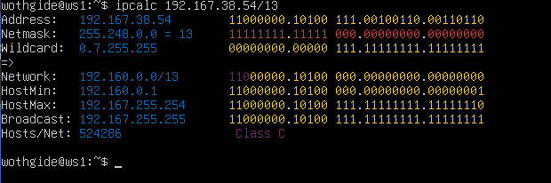

2)  Перевод маски 255.255.255.0 в префиксную и двоичную запись, /15 в обычную и двоичную, 11111111.11111111.11111111.11110000 в обычную и префиксную
* Префиксная запись маски 255.255.255.0 в поле Network: /24
* Двоичная запись маски 255.255.255.0 в поле Netmask: 11111111.11111111.11111111.0000000


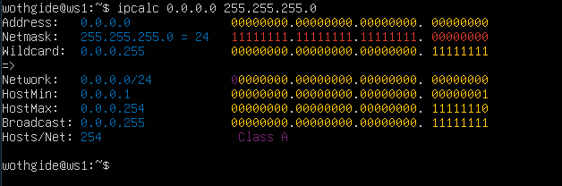

 
* /15 в обычной записи в поле Netmask: 255.254.0.0
* /15 в двоичной записи также в поле Netmask: 1111111.11111110.00000000.0000000


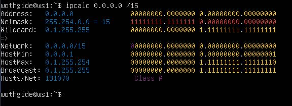


* В обычной форме: 255.255.255.240
* В префиксной форме: /28


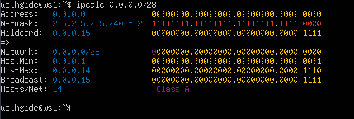

3) Минимальный и максимальный хост в сети 12.167.38.4 при масках: /8, 11111111.11111111.00000000.00000000, 255.255.254.0 и /48
 
* 
Минимальный хост сети: 12.0.0


* 
Максимальный хост сети: 12.255.255.


(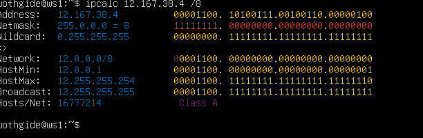


* Минимальный хост сети: 12.167.0.1

  
* 
Максимальный хост сети: 12.167.255.25


  (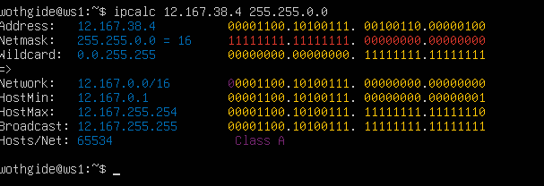


* 
Минимальный хост сети: 12.167.38.
  1* 
Максимальный хост сети: 12.167.39.2


5(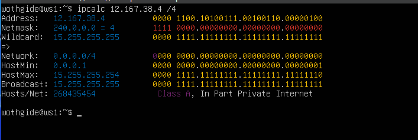)

)

o2

54

### 1.2. localhost
Определи и запиши в отчёт, можно ли обратиться к приложению, работающему на localhost, со следующими IP: 194.34.23.100, 127.0.0.2, 127.1.0.1, 128.0.0.1

* можно обратиться:

127.0.0.1

127.0.0.2


* нельзя обратиться:

194.34.23.100

127.1.0.1

### 1.3. Диапазоны и сегменты сетей

Определи и запиши в отчёт:

1) Какие из перечисленных IP можно использовать в качестве публичного, а какие только в качестве частных: 10.0.0.45, 134.43.0.2, 192.168.4.2, 172.20.250.4, 172.0.2.1, 192.172.0.1, 172.68.0.2, 172.16.255.255, 10.10.10.10, 192.169.168.1

* Частные: 10.0.0.45, 192.168.4.2, 10.10.10.10, 172.20.250.4, 172.16.255.255


* Публичные: 134.43.0.2, 172.0.2.1, 192.172.0.1, 172.68.0.2, 192.169.168.1

 2) Какие из перечисленных IP адресов шлюза возможны у сети 10.10.0.0/18: 10.0.0.1, 10.10.0.2, 10.10.10.10, 10.10.100.1, 10.10.1.255

* IP адреса шлюза возможные у сети 10.10.0.0/18:  10.10.0.2, 10.10.10.10, 10.10.1.255

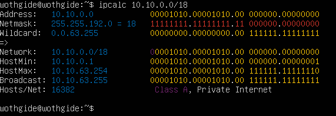

# Part 2. Статическая маршрутизация между двумя машинами

#### Подними две виртуальные машины (далее -- ws1 и ws2).

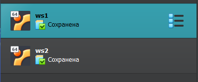

#### С помощью команды ip a посмотри существующие сетевые интерфейсы.


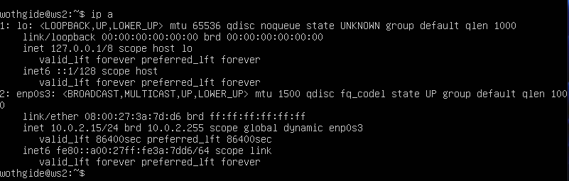

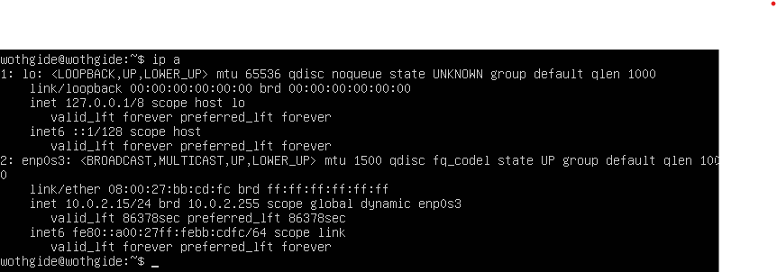

#### Опиши сетевой интерфейс, соответствующий внутренней сети, на обеих машинах и задать следующие адреса и маски: ws1 - 192.168.100.10, маска /16, ws2 - 172.24.116.8, маска /12.

Сетевой интерфейс, соответствующий внутренней сети, это интерфейс, который подключен к локальной сети внутри организации или домашней сети и предназначен для обмена данными между устройствами в этой сети. Обычно такие интерфейсы имеют адреса из частных IP-диапазонов, например, 192.168.x.x, 172.16.x.x - 172.31.x.x или 10.x.x.x.

Кроме того, внутренний интерфейс может иметь дополнительные параметры безопасности, такие как настройки брандмауэра, чтобы защитить локальную сеть от внешних угроз.

Вывод команды ip a (ws1):


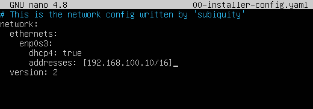


Вывод команды ip a (ws2):


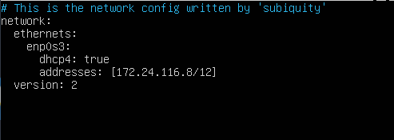

#### Выполни команду netplan apply для перезапуска сервиса сети.

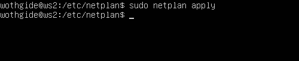


### 2.1. Добавление статического маршрута вручную

#### Добавь статический маршрут от одной машины до другой и обратно при помощи команды вида ip r add.

Добавляем статический маршрут от ws1 до ws2:

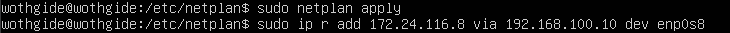

Добавляем статический маршрут от ws2 до ws1:

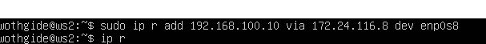

Пропингуй соединение между машинами.

Пропинговала ws2 с ws1:

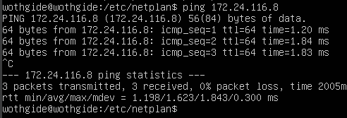


Пропинговала ws1 с ws2:

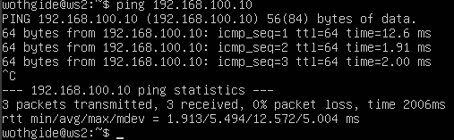

### 2.2. Добавление статического маршрута с сохранением

Перезапусти машины.

Добавь статический маршрут от одной машины до другой с помощью файла /etc/netplan/00-installer-config.yaml.

ws2:

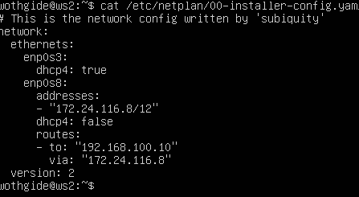

ws1:

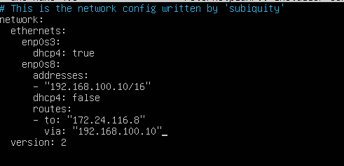

Пропингуй соединение между машинами.

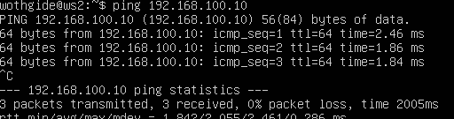

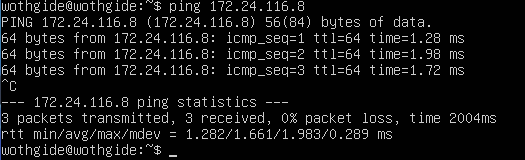

# Part 3. Утилита iperf3


### 3.1. Скорость соединения

Переведи и запиши в отчёт: 8 Mbps в MB/s, 100 MB/s в Kbps, 1 Gbps в Mbpsbps

Перевод записи:


8 Mbps = 1 MB/

s
100 MB/s = 819200 Kb


ps
1 Gbps = 1024 M
bps

### 3.2. Утилита iperf3


Измерь скорость соединения между ws1 и ws2.

Выполнил команду iperf3 -s на ws1, что бы настроить её как сервер:

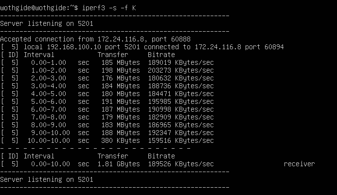


Выполнил команду iperf3 -c 192.168.100.10 на ws2, что бы настроить её как клиент и измерить скорость соединения между машинами:


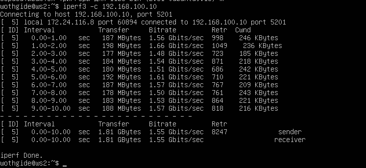

# Part 4. Сетевой экран

### 4.1. Утилита iptables
Создай файл /etc/firewall.sh, имитирующий фаерволл, на ws1 и ws2 и добавить в файлы /etc/firewall.sh на ws1 и ws2 новые правила, в соответствии с заданием.

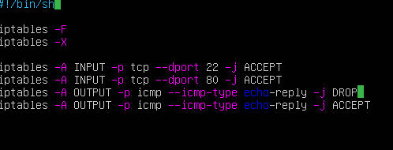

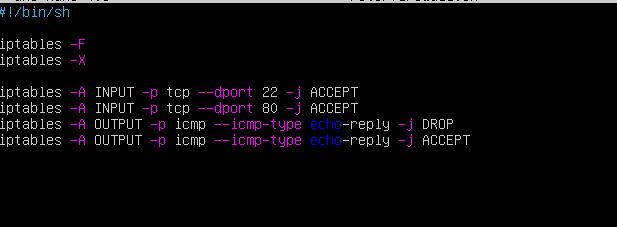

Запусти файлы на обеих машинах командами chmod +x /etc/firewall.sh и /etc/firewall.sh.

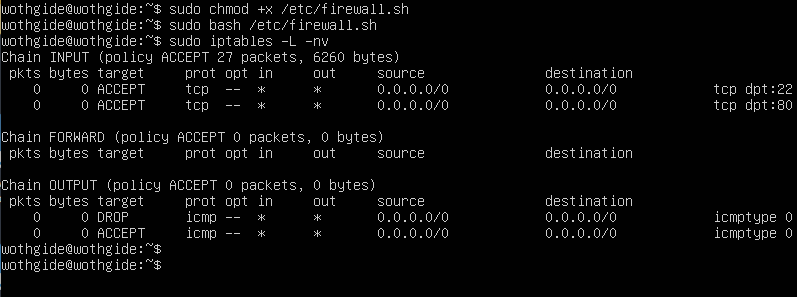

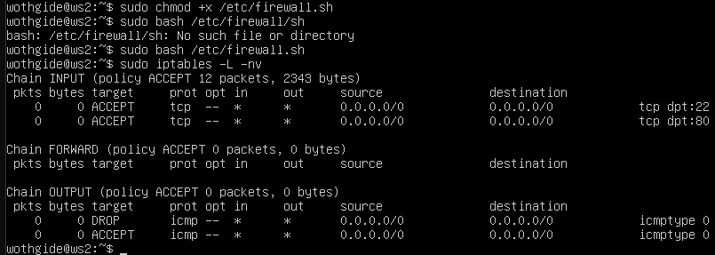 

Первый файл содержит запрещающее правило на выход в начале списка правил, что приводит к тому, что первая машина не может пропинговать другую машину. Второй файл содержит разрешающее правило в начале списка правил, что позволяет второй машине пропинговать другую. Различие между стратегиями в том, что в утилите iptables правила выполняются сверху вниз, то есть если правило запрета находиться выше оно срабатывает, а правило разрешения находящиеся ниже - нет.

### 4.2. Утилита nmap

Командой ping найди машину, которая не «пингуется», после чего утилитой nmap покажи, что хост машины запущен.


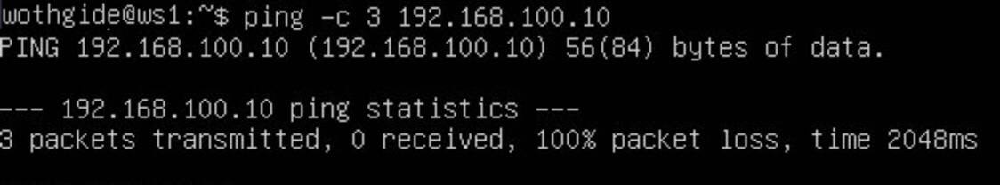

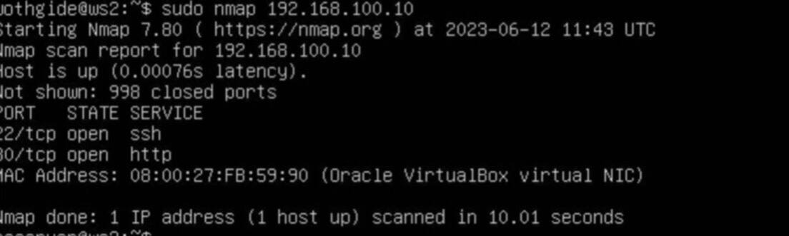


Как и предполагалось ws1 не може пинговаться ws2 из за настроек таблицы FILTER в цепи INPUT, которые мы сделали в заданиях выше, в то время как ws1 может пинговать ws2.

# Part 5. Статическая маршрутизация сети

Подними пять виртуальных машин (3 рабочие станции (ws11, ws21, ws22) и 2 роутера (r1, r2)).

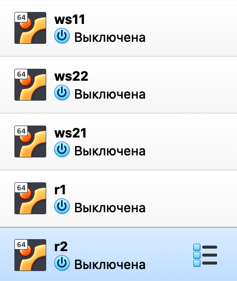

Сеть: 
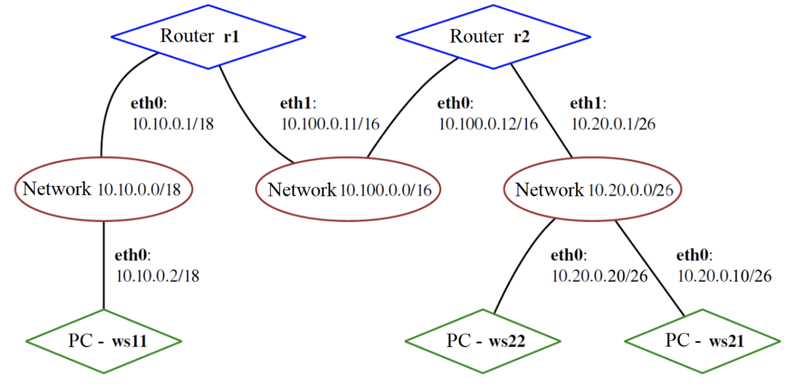


### 5.1. Настройка адресов машин

Настрой конфигурации машин в etc/netplan/00-installer-config.yaml согласно сети на рисунке.

ws11:


ws21:


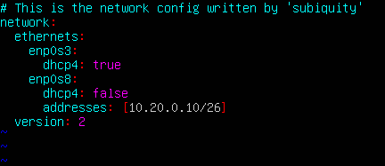

ws22:


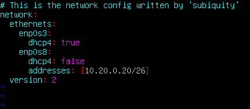

r1:


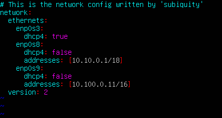

r2:


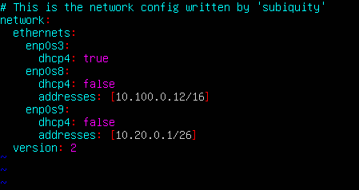

Перезапусти сервис сети. Если ошибок нет, то командой ip -4 a проверь, что адрес машины задан верно. Также пропингуй ws22 с ws21. Аналогично пропингуй r1 с ws11.

Перезапустила командой sudo netplan apply

ws22:
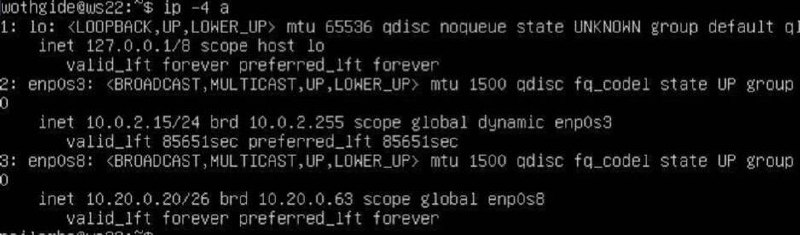

ws11:
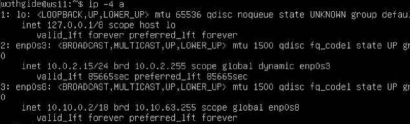

ws21:
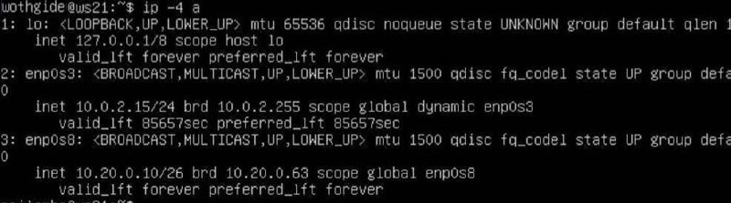

r1:
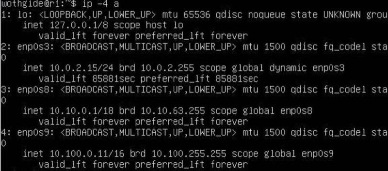

r2:
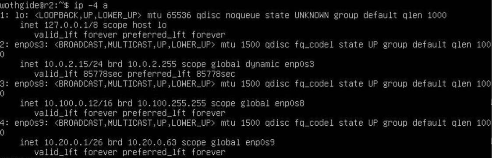


Успешно пропингованный ip 10.10.0.1:

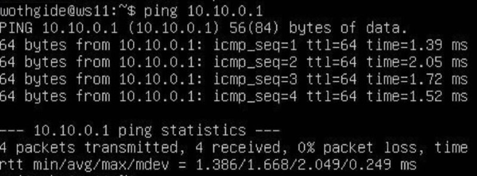


Успешно пропингованный ip 10.20.0.20:

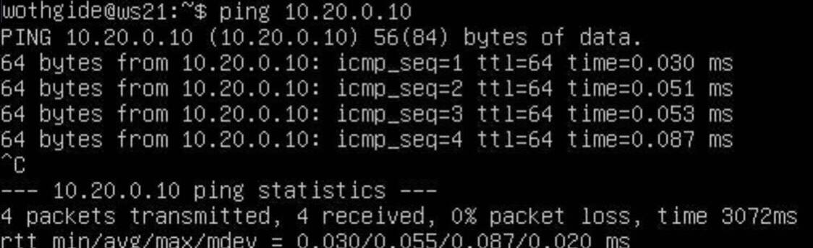

### 5.2. Включение переадресации IP-адресов

Для включения переадресации IP, выполняем  команду на роутерах:
sysctl -w net.ipv4.ip_forward=1


r1:
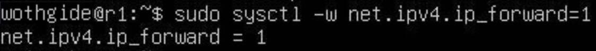

r2:
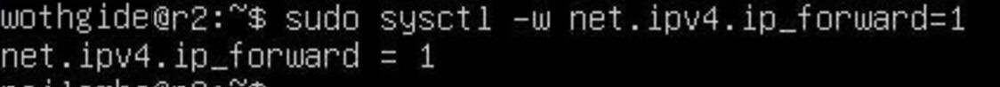

Открой файл /etc/sysctl.conf и добавь в него следующую строку:

r1:

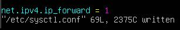

r2:

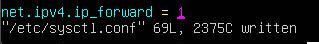

### 5.3. Установка маршрута по-умолчанию

Настрой маршрут по-умолчанию (шлюз) для рабочих станций. Для этого добавь default перед IP роутера в файле конфигураций:

Изменилa файлы конфигурации etc/netplan/00-installer-config.yaml на ws11, ws21, ws22:

ws11:


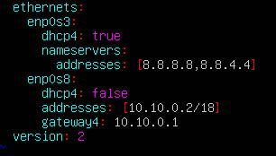


ws21:


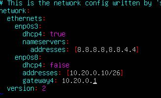


ws22:


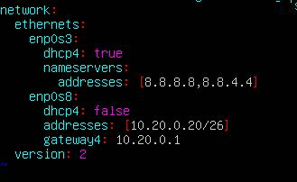


Вызови ip r и покажи, что добавился маршрут в таблицу маршрутизации.


ws22:


ws21:


ws11:


Пропингуй с ws11 роутер r2 и покажи на r2, что пинг доходит. 

Вывод команды sudo tcpdump -tn -i enp0s8 (r2):


Вывод команды ping 10.100.0.12 (ws11):


### 5.4. Добавление статических маршрутов

Добавь в роутеры r1 и r2 статические маршруты в файле конфигураций. 

r1:


r2:


Вызови ip r и покажи таблицы с маршрутами на обоих роутерах.


Запусти команды на ws11:
ip r list 10.10.0.0/[маска сети] и ip r list 0.0.0.0/0


У нас уже есть правило для первого адреса, поэтому используется именно этот маршрут, а не 
стандартный, так как у стандартного маршрута приоритет меньше.
ю.


### 5.5. Построение списка маршрутизаторов

Вывод команды traceroute 10.20.0.10 (ws11):


ws11:


r1:


Принцип работы traceroute: Утилита отправляет целевому узлу несколько пакетов с временем жизни 1 (TTL, time to live - число переходов, которые пакет может осуществить до своего исчезновения). Следующий маршрутизатор принимает пакеты и отправляет сообщение, что время жизни пакетов истекло. traceroute фиксирует адрес этого маршрутизатора и отправляет следующие пакеты, уже с TTL 2. Так, каждый раз увеличивая TTL на 1, traceroute составляет список маршрутизаторов, через которе прошли пакеты до целевого узла.

### 5.6. Использование протокола ICMP при маршрутизации

Запусти на r1 перехват сетевого трафика, проходящего через eth0 с помощью команды:
tcpdump -n -i eth0 icmp


Пропингуй с ws11 несуществующий IP (например, 10.30.0.111) с помощью команды:
ping -c 1 10.30.0.111


### Part 6. Динамическая настройка IP с помощью DHCP

Для r2 настрой в файле /etc/dhcp/dhcpd.conf конфигурацию службы DHCP:

1) Укажи адрес маршрутизатора по-умолчанию, DNS-сервер и адрес внутренней сети. Пример файла для r2:


 

2) В файле resolv.conf пропиши nameserver 8.8.8.8.

 

ws21 ip a:


 

ws21 pings ws22:


 


Отредактированный файл /etc/netplan/00-installer-config.yaml (ws11):


 


r1 dhcp config:


 


 ws11 до изменений:


 ws11 после изменений:


# Part 7. NAT


В файле /etc/apache2/ports.conf на ws22 и r1 измени строку Listen 80 на Listen 0.0.0.0:80, то есть сделай сервер Apache2 общедоступным.


ws22:


r1:


Запусти веб-сервер Apache командой service apache2 start на ws22 и r1.


Скрипт-файл /etc/firewall.sh на r2:


Успешно пропингованный ip 10.20.0.20 (r1):


Измененный файл /etc/firewall.sh (r2):


Успешно пропингованный ip 10.20.0.20 (r1):


Измененный файл /etc/firewall.sh (r2):


Проверил соединение по TCP для SNAT: для этого с ws22 подключиться к серверу Apache на r1 командой telnet 10.10.0.1 80.


Вывод команды telnet 10.10.0.1 80 (ws22):


Вывод команды telnet 10.20.0.1 8080 (r1):


### Part 8. Дополнительно. Знакомство с SSH Tunnels
Нужно установить openssh-server на машины


Действующие правила iptables (r2):


Измененный файл /etc/apache2/ports.conf (ws22):


Успешное подключение по ssh с ws21 к ws22:


Успешное подключение по ssh с ws11 к ws22:


ws21 telnet 127.0.0.1 8080:


ws11 telnet 127.0.0.1 8080:


```python

```
