# Simple Docker

1. Готовый докер 
2. Операции с контейнером 
3. Мини веб-сервер 
4. Свой докер 
5. Dockle 
6. Базовый Docker Compose

###  1. Готовый докер

* Возьми официальный докер-образ с nginx и выкачай его при помощи docker pull и проверь наличие докер-образа через docker images:

  
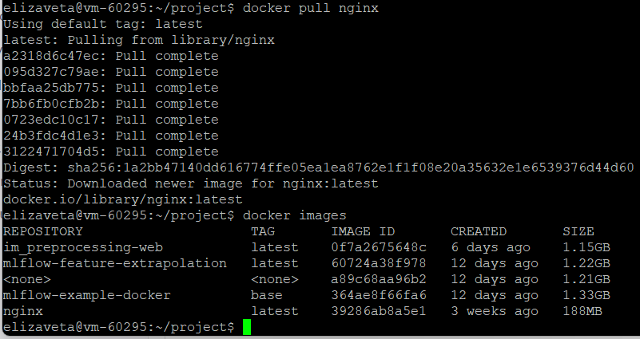

* Запусти докер-образ через docker run -d [image_id|repository] и проверь, что образ запустился через docker ps.

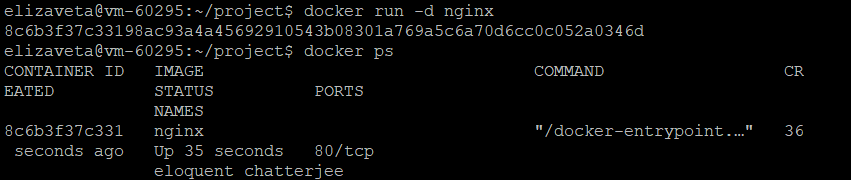

* Посмотри информацию о контейнере через docker inspect [container_id|container_name]:

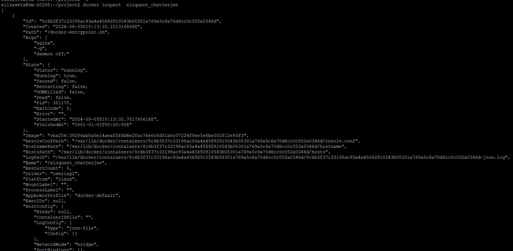

* По выводу команды определи и помести в отчёт размер контейнера, список замапленных портов и ip контейнера.

размер контейнера:

  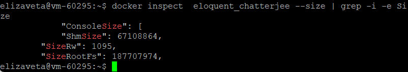
  
  
список замапленных портов:

  
  

ip контейнера:

  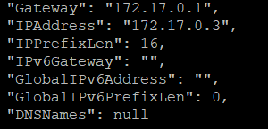
  

* Останови докер контейнер через docker stop [container_id|container_name].

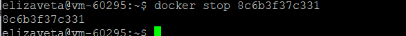

* Проверь, что контейнер остановился через docker ps:

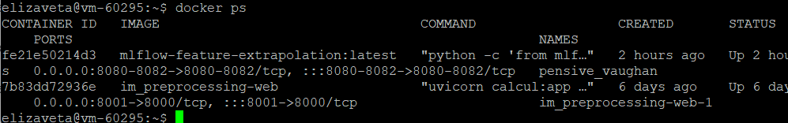

* Запусти докер с портами 80 и 443 в контейнере, замапленными на такие же порты на локальной машине, через команду run:

 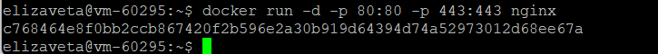

* Проверь, что в браузере по адресу localhost:80 доступна стартовая страница nginx:

 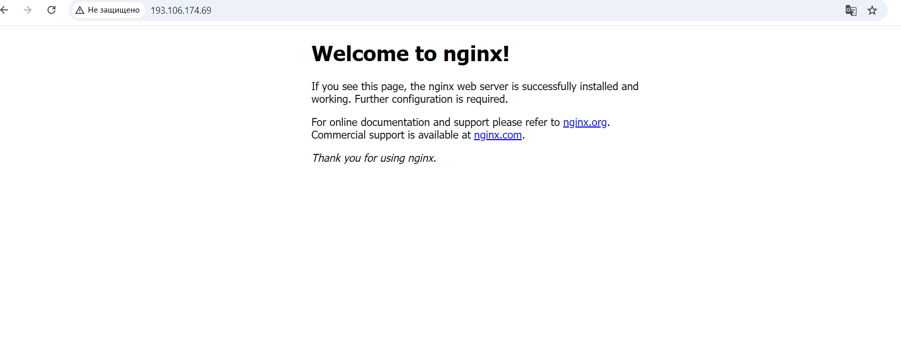

* Перезапусти докер контейнер через docker restart [container_id|container_name] и проверь любым способом, что контейнер запустился:

 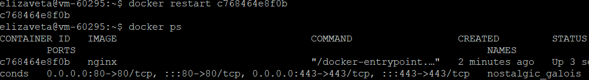

 

 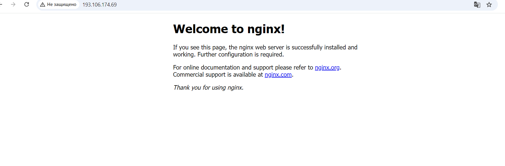

### Part 2. Операции с контейнером

* Прочитай конфигурационный файл nginx.conf внутри докер контейнера через команду exec:
 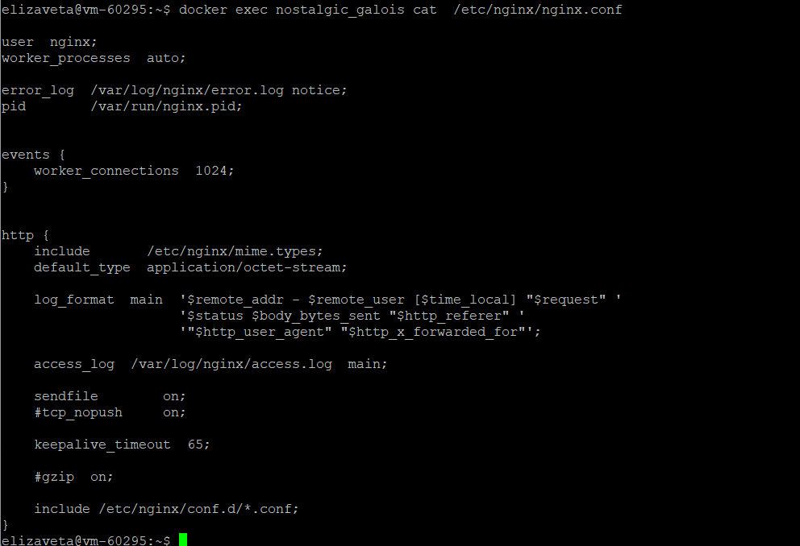

* Создай на локальной машине файл nginx.conf. Настрой в нем по пути /status отдачу страницы статуса сервера nginx:

   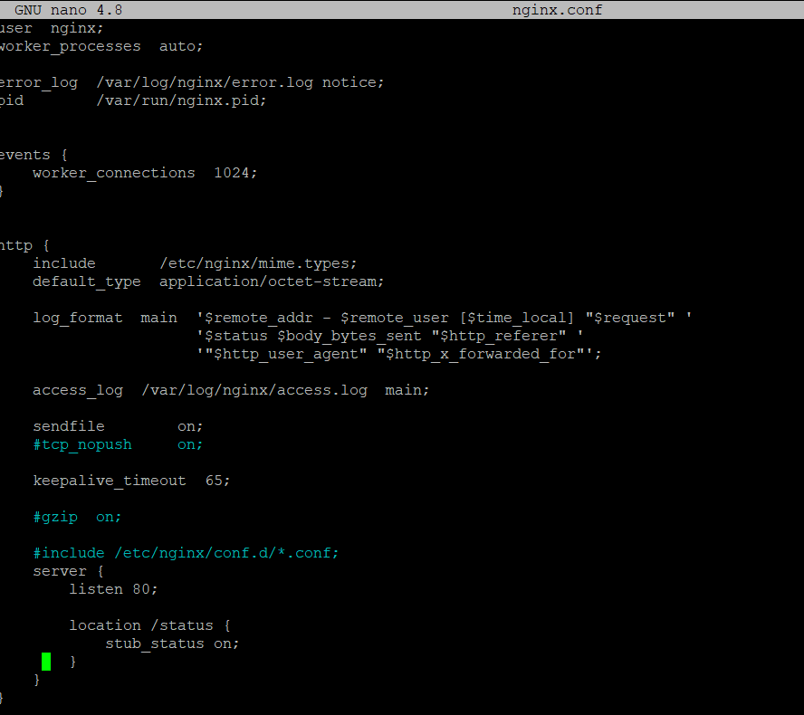

* Скопируй созданный файл nginx.conf внутрь докер-образа через команду docker cp:

 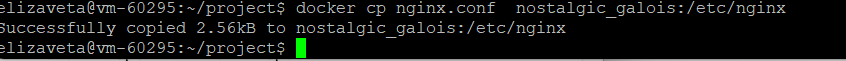
 

* Перезапусти nginx внутри докер-образа через команду exec:

 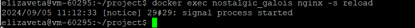

* Проверь, что по адресу localhost:80/status отдается страничка со статусом сервера nginx:

 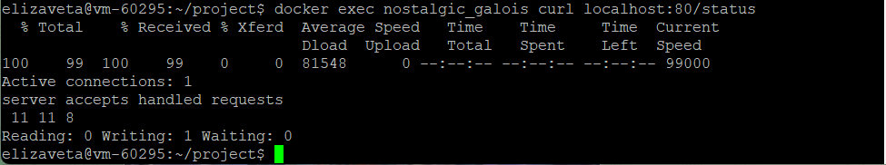

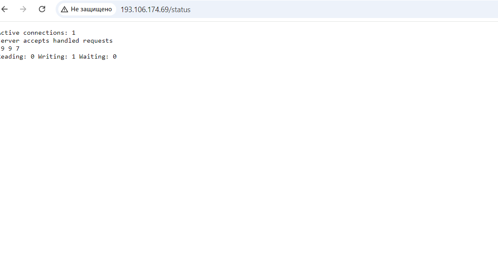

* Экспортируй контейнер в файл container.tar через команду export. Останови контейнер.:

 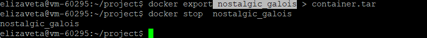

* Удали образ через docker rmi [image_id|repository], не удаляя перед этим контейнеры. Удали остановленный контейнер:

 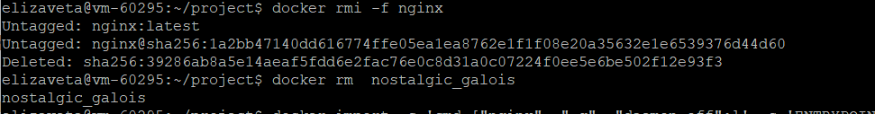
 

* Импортируй контейнер обратно через команду import.Запусти импортированный контейнер:

 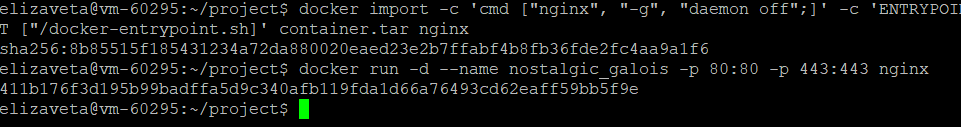 

* Проверь, что по адресу localhost:80/status отдается страничка со статусом сервера nginx:

 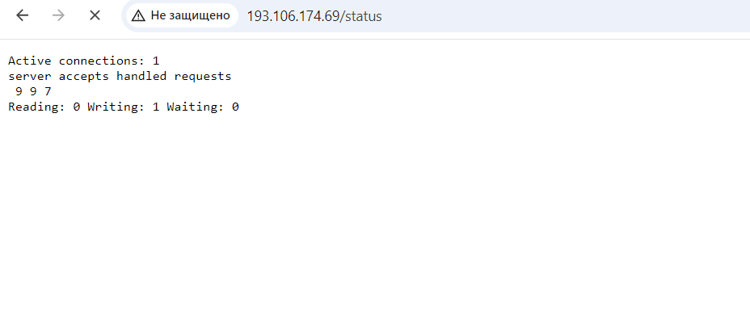

### Part 3. Мини веб-сервер

Напиши мини-сервер на C и FastCgi, который будет возвращать простейшую страничку с надписью Hello World!.

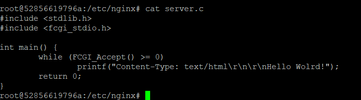 

Запусти написанный мини-сервер через spawn-fcgi на порту 8080.

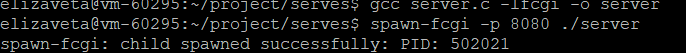 

Напиши свой nginx.conf, который будет проксировать все запросы с 81 порта на 127.0.0.1:8080.

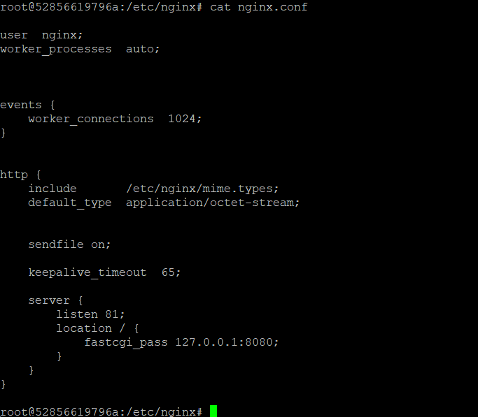 

Скопировала файлы в контейнер:

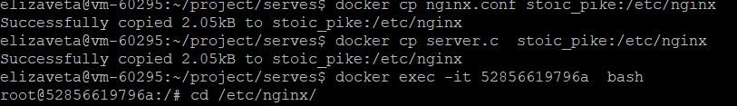 

Запустила сервис:

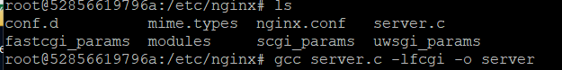

Перезапустила nginx:

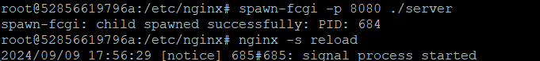

Проверь, что по localhost:81 отдается написанная тобой страничка.

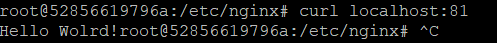 

Положи файл nginx.conf по пути ./nginx/nginx.conf (это понадобится позже).

# Part 4. Свой докер

Создала Dockerfile, который использует базовый nginx. Монтируем дирректории внутрь контейнера и прописываем установку, необходимых :

   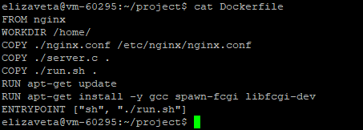

Создала файл entrypoint:

   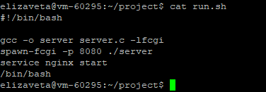 

Собираю написанный докер-образ через docker build, указаваю имя и тег: 

  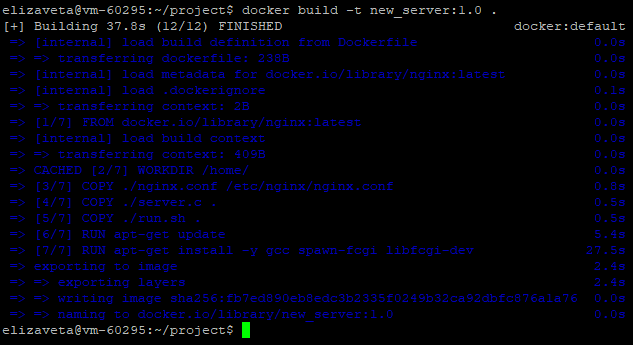 

Проверяю наличие образа командой: docker images:

  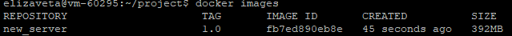 
  

Запускаю собранный докер-образ с маппингом 81 порта на 80 на  и монтированием папки ./nginx внутрь контейнера по адресу, где лежат конфигурационные файлы nginx'а:

  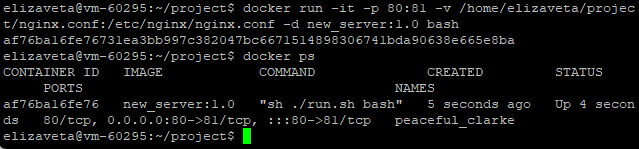 

Проверяю, что по localhost:80 доступна страничка написанного мини сервера:

  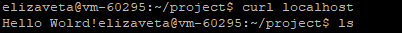 

  
  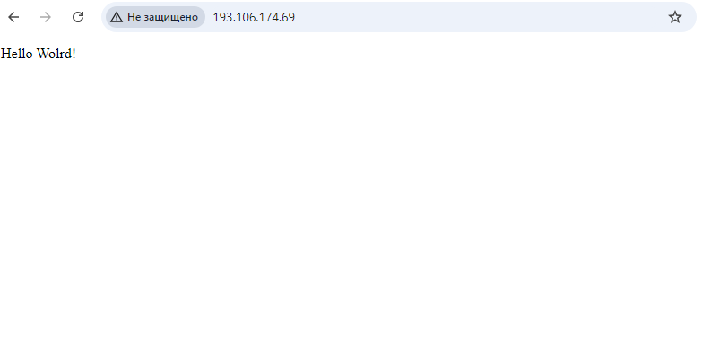 

  
Допиcала в ./nginx/nginx.conf проксирование странички /status, по которой надо отдавать статус сервера nginxЖ

  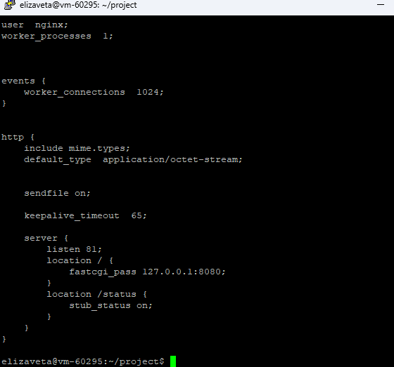 

Вошла в контейнер и перезапустила nginx:

  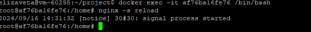 

  
Проверь, что теперь по localhost:80/status отдается страничка со статусом nginx:

  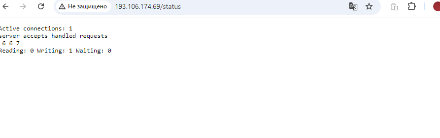 

# Part 5. Dockle

Для начала необходимо установить утилиту Dockle.

Проверяяем утилитой Dockle:

 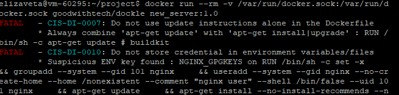

 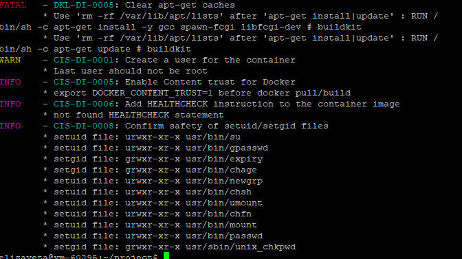

 Исправляем ошибки в Dockerfile и пересобираем контейнер:

 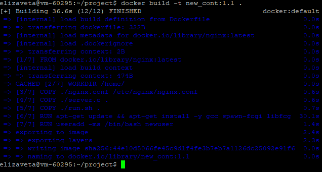

 Проверяем изменения:
 

  
 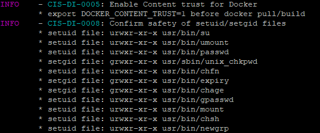

# Part6. Basic Docker Compose

Для начала необходимо устновить docker-compose, если он не устновился с docker. 

Потом необходимо остановить существующие к контейнеры.

 
 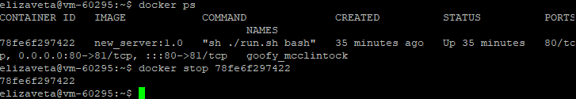

Напишем конфигурационный файл docker-compose.yml

 
 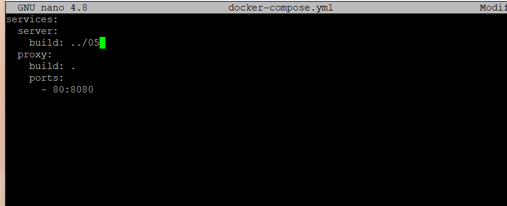

 Пересобираем и запускам:

  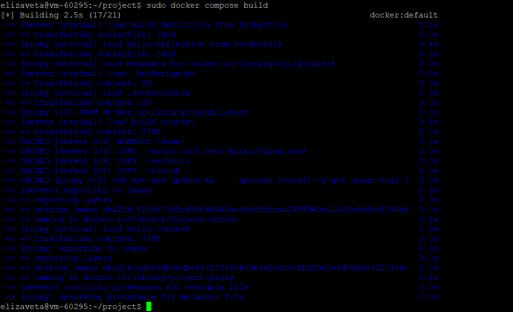

  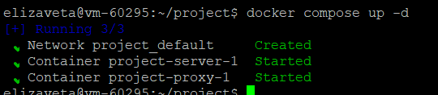

  Контейнеры поднялись, проверяем в барузере ответ:

  
  
  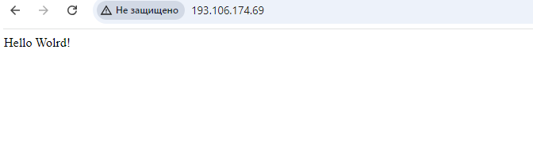
