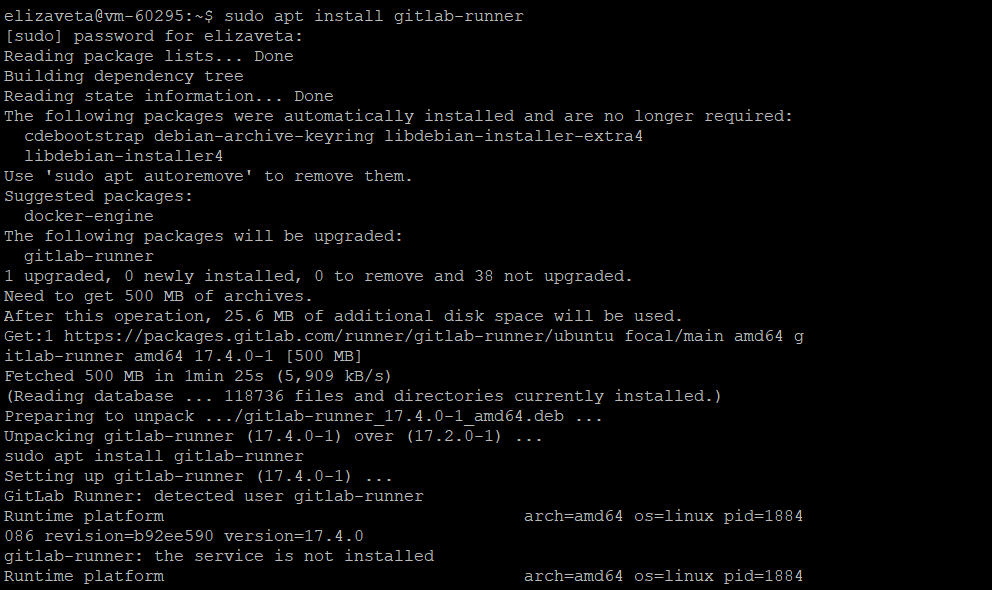
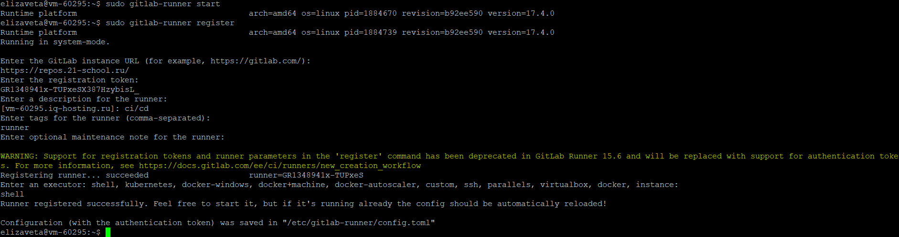
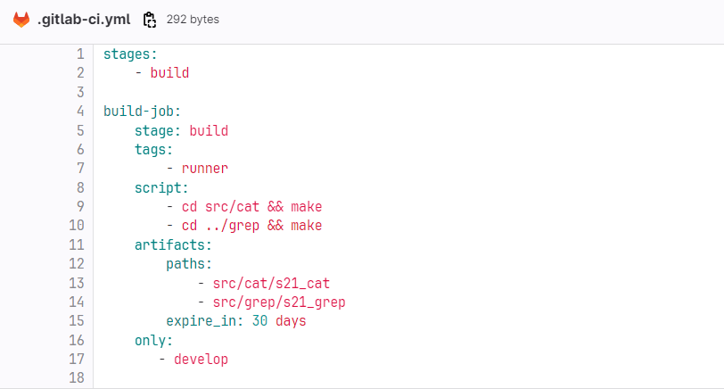
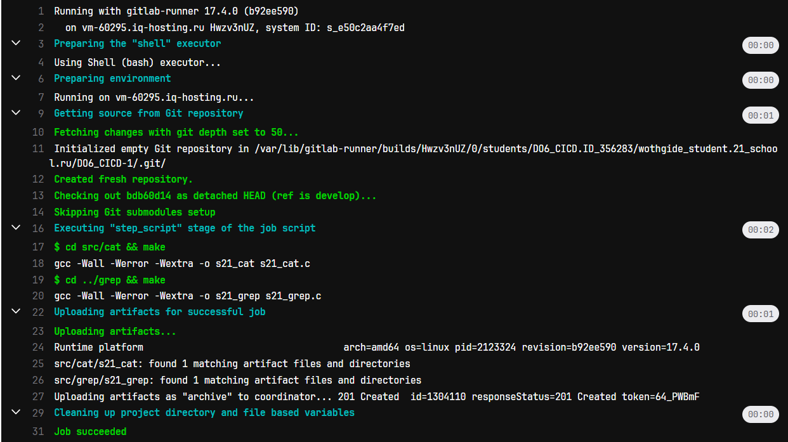
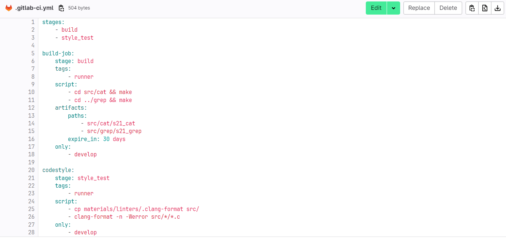
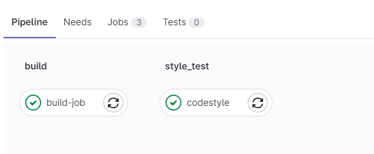
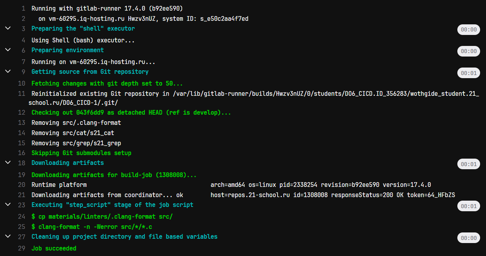
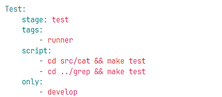
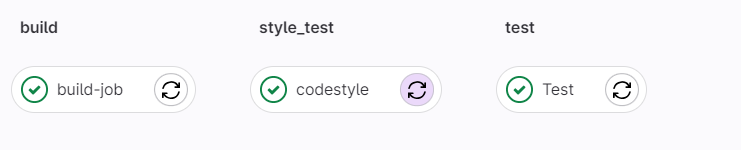
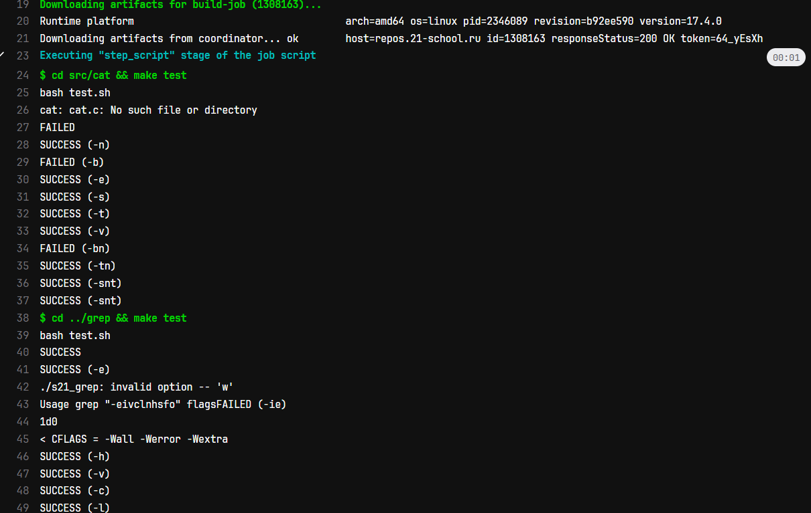

# Basic CI/CD

1. Настройка gitlab-runner
2. Сборка
3. Тест кодстайла
4. Интеграционные тесты
5. Этап деплоя
6. Дополнительно. Уведомления


### Part 1. Настройка gitlab-runner
 

* Подняла виртуальную машину:


* Следующий шаг устнановить gitlab runner:

``sudo apt install gitlab-runner``




* Запусти gitlab-runner и зарегистрируй его для использования в текущем проекте (DO6_CICD).

``sudo gitlab-runner start ``

``sudo gitlab-runner register ``




### Part 2. Сборка

Напиши этап для CI по сборке приложений из проекта C2_SimpleBashUtils.


* В файле gitlab-ci.yml добавь этап запуска сборки через мейк файл из проекта C2_SimpleBashUtils.

Создала файл gitlab-ci.yml в корне дирректории, перенесла дирректории cat и grep из проекта C2_SimpleBashUtils, написала скрипт сборки проекта для cat и grep.

 


 Запустила pipline:

 

* Файлы, полученные после сборки (артефакты), сохрани в произвольную директорию со сроком хранения 30 дней.


### Part 3. Тест кодстайла
Напиши этап для CI, который запускает скрипт кодстайла (clang-format).
Перед этим необходимо установить на ВМ clang-format:

``` apt-get install clang-format ```


Если кодстайл не прошел, то «зафейли» пайплайн. В данной ситуации тест на кодстайл прошел:




В пайплайне отобрази вывод утилиты clang-format.





### Part 4. Интеграционные тесты

Напиши этап для CI, который запускает твои интеграционные тесты из того же проекта.
Запусти этот этап автоматически только при условии, если сборка и тест кодстайла прошли успешно.




Если тесты не прошли, то «зафейли» пайплайн.



В пайплайне отобрази вывод, что интеграционные тесты успешно прошли / провалились.



### Part 5. Этап деплоя

Подними вторую виртуальную машину Ubuntu Server 22.04 LTS.

Напиши этап для CD, который «разворачивает» проект на другой виртуальной машине.

Запусти этот этап вручную при условии, что все предыдущие этапы прошли успешно.

Напиши bash-скрипт, который при помощи ssh и scp копирует файлы, полученные после сборки (артефакты), в директорию /usr/local/bin второй виртуальной машины.
Тут тебе могут помочь знания, полученные в проекте DO2_LinuxNetwork.

Будь готов объяснить по скрипту, как происходит перенос.


В файле gitlab-ci.yml добавь этап запуска написанного скрипта.

В случае ошибки «зафейли» пайплайн.
В результате ты должен получить готовые к работе приложения из проекта C2_SimpleBashUtils (s21_cat и s21_grep) на второй виртуальной машине.

Сохрани дампы образов виртуальных машин.
P.S. Ни в коем случае не сохраняй дампы в гит!

Не забудь запустить пайплайн с последним коммитом в репозитории.